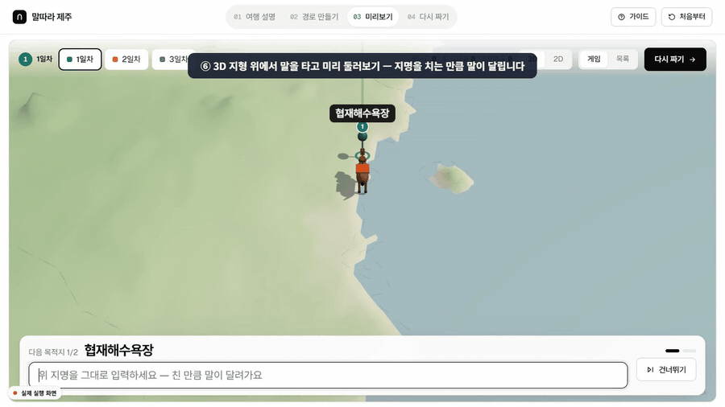
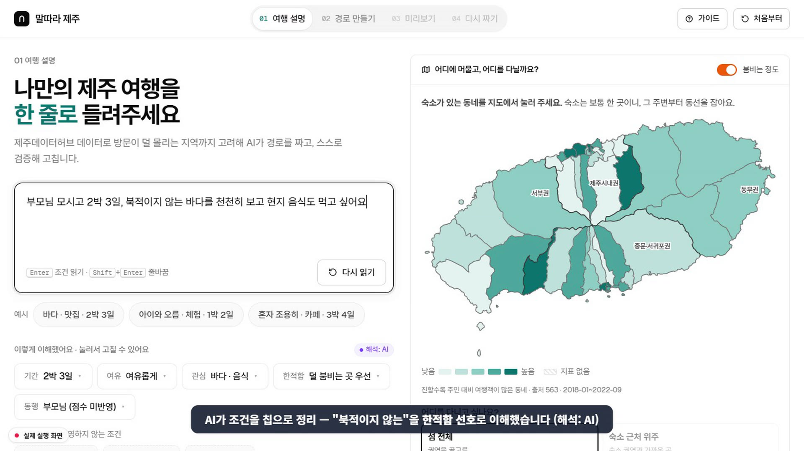
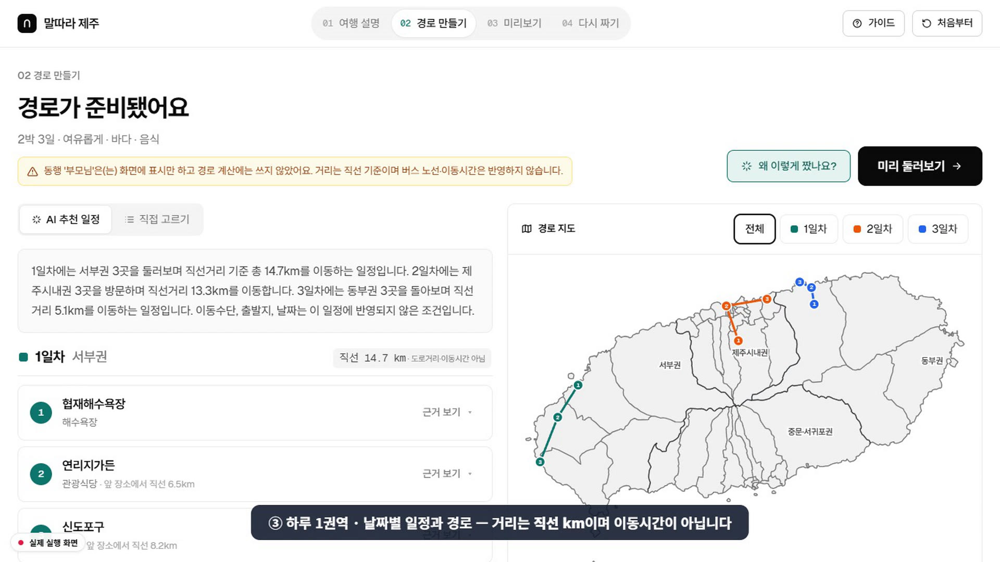
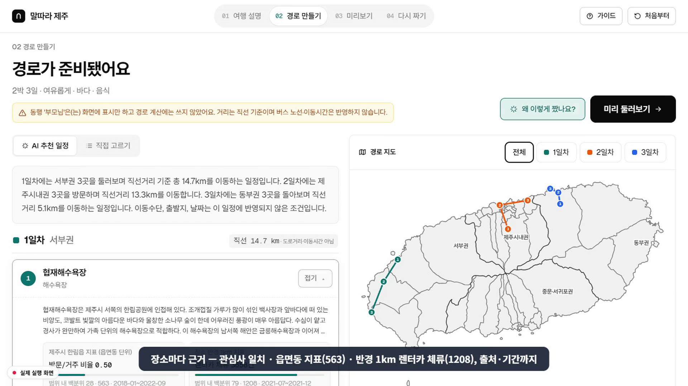
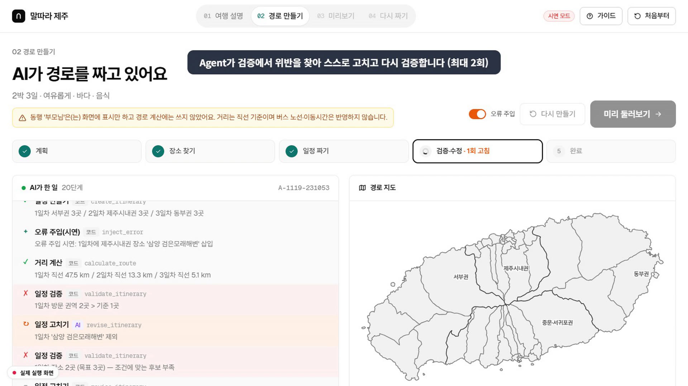
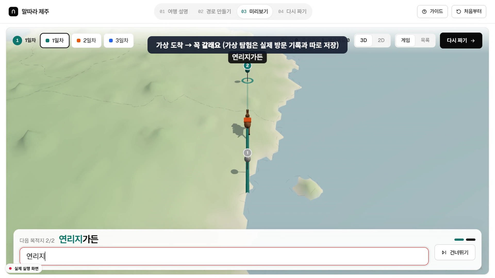
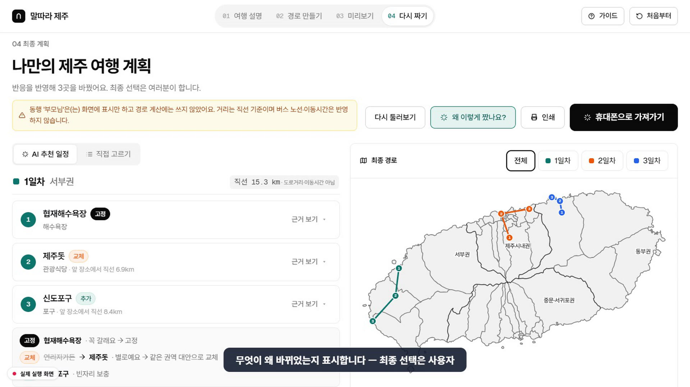
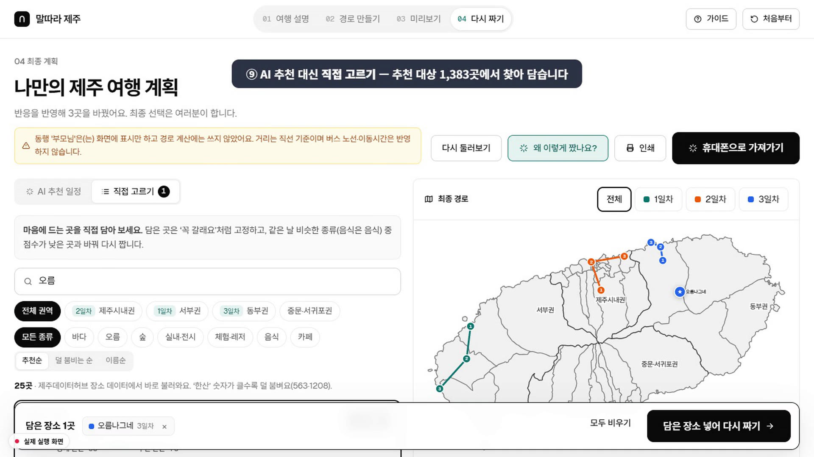
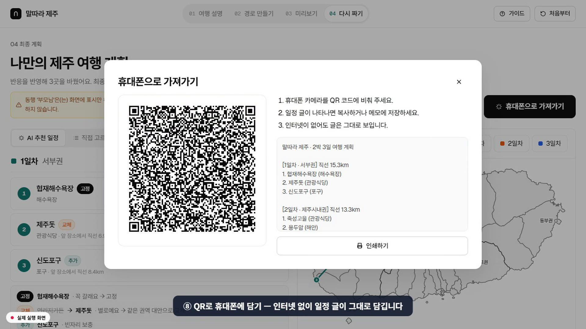
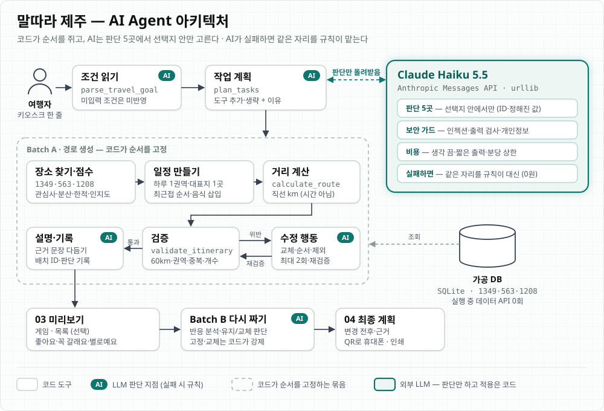

<div align="center">

# 🐴 말따라 제주

### 데이터로 **덜 붐비는 제주**를 찾아 주는 여행 경로 AI Agent

한 줄로 말하면 → 경로를 짜고 → 스스로 검증해 고치고 → 말을 타고 미리 둘러본 반응으로 다시 짭니다

<sub>제주 AI·빅데이터 활용 AI Agent 개발 챌린지 출품작 · 제주빅데이터센터 체험형 키오스크</sub>

<br>


<br>

<a href="https://github.com/jomin4/contest-malttara-jeju/releases/download/demo-2026-11-19/malttara-jeju-demo.mp4">
  
</a>

**[▶ 전체 시연 영상 보기 (2분 29초)](https://github.com/jomin4/contest-malttara-jeju/releases/download/demo-2026-11-19/malttara-jeju-demo.mp4)** · 타이틀·아웃트로를 빼면 모두 실제 실행 화면입니다

</div>

---

## 왜 만들었나

제주 여행 정보는 유명 관광지에 몰려 있습니다. 같은 관심사(예: 바다)를 가진 여행자가 같은 곳으로 모이고, 비슷한 경험을 할 수 있는 다른 동네·장소는 잘 드러나지 않습니다. **제주데이터허브에는 이 쏠림을 직접 보여 주는 데이터가 있습니다.**

| | 데이터 | 차이 |
|---|---|---|
| 동네마다 찾아오는 비율이 다르다 | 563 내국인 유동인구 구성비율 (2018-01~2022-09) | 읍면동 방문/거주 비율 **제주시 삼양동 0.225 ↔ 도두동 2.660, 약 12배** |
| 같은 동네 안에서도 장소마다 다르다 | 1208 렌터카 체류 거점 (2021 하반기 토요일) | 같은 조천읍 해수욕장, 반경 1km 체류 **함덕 4,403건 ↔ 신흥 314건, 14배** |

말따라 제주는 여행자의 한 줄 요청을 이해하고, 이 데이터로 **관심사에 맞으면서 방문이 덜 몰리는 장소**를 골라 하루 동선으로 묶어 줍니다.

---

## 무엇을 하나

<table>
<tr>
<td width="50%"><br><b>① 한 줄로 말하기</b><br>AI가 조건을 칩으로 정리합니다. "북적이지 않는"을 한적함 선호로 이해하고, 말하지 않은 조건은 <b>미반영</b>으로 둡니다.</td>
<td width="50%"><br><b>② 경로 만들기</b><br>하루 1권역, 날짜별 일정과 지도. 거리는 <b>직선 km</b>로 표시하고 이동시간처럼 말하지 않습니다.</td>
</tr>
<tr>
<td><br><b>③ 장소마다 근거</b><br>관심사 일치 · 읍면동 지표(563) · 반경 1km 렌터카 체류(1208)를 출처·기간과 함께 보여 줍니다.</td>
<td><br><b>④ 스스로 검증하고 고치기</b><br>시연 모드에서 일부러 오류를 넣으면, Agent가 위반을 찾아 고치고 다시 검증합니다(최대 2회).</td>
</tr>
<tr>
<td><br><b>⑤ 말 타고 미리 둘러보기</b><br>3D 지형 위에서 지명을 치는 만큼 말이 달리고, 가상 도착하면 좋아요·꼭 갈래요·별로예요. 게임은 선택이며 2D·목록으로도 같은 기능을 씁니다.</td>
<td><br><b>⑥ 반응으로 다시 짜기</b><br>꼭 갈래요는 고정, 별로예요는 교체(코드가 강제). 무엇이 왜 바뀌었는지 전후를 비교합니다.</td>
</tr>
<tr>
<td><br><b>⑦ 직접 고르기</b><br>추천 대상 1,383곳에서 찾아 담으면, 직접 고른 장소는 항상 고정하고 다시 짭니다.</td>
<td><br><b>⑧ 휴대폰으로 가져가기</b><br>QR을 찍으면 일정 글이 그대로 담깁니다. 인터넷이 없어도 되고, 인쇄도 됩니다.</td>
</tr>
</table>

---

## 어떻게 동작하나

<p align="center"></p>

- **Plan-and-Execute** — 필수 단계(조건 검증 → 장소 탐색 → 일정 생성 → 거리 계산 → 검증·수정 → 설명·기록)는 코드가 순서를 고정하고, **작업 계획**이 조건에 따라 도구를 더하거나 뺍니다. 실행 로그에 "추가/생략 + 이유"와 판단 주체(AI/규칙)가 남습니다.
- **AI는 판단 5곳에서만** — 조건 해석, 작업 계획, 수정 행동 선택, 유지·교체, 설명 문장 다듬기. 주어진 선택지(정해진 키·값, 허용 도구, 장소 ID) 안에서만 고르고, **수치 계산·검증·적용은 언제나 코드**가 합니다.
- **장소 점수** = 0.5 × 관심사 + 0.15 × 분산(563) + 0.15 × 한적(1208) + 0.2 × 인지도(1349). 하루마다 대표지 1곳을 넣어 덜 붐비는 곳'만' 나오지 않게 합니다.

## 설계에서 신경 쓴 것

| | 내용 |
|---|---|
| 🔢 **수치는 코드만** | LLM 출력 스키마에 수치 필드가 없고, 다듬은 문장에 원래 없던 숫자가 생기면 버립니다. 읍면동 통계를 장소의 속성처럼 말하지 않습니다. |
| 🛡️ **LLM 보안** | 프롬프트 인젝션 탐지(의심 문장은 AI에 보내지 않고 규칙으로), 사용자 입력 경계 태그, 화면에 뜨는 AI 문장 출력 검사, 개인정보 마스킹(해석·전송·저장 전), 분당 호출 상한. → [`security.md`](docs/05_submission/security.md) |
| 💸 **비용** | 가장 저렴한 Claude Haiku 5.5를 짧은 출력으로만 호출. 실측 **방문객 1명 전체 체험 약 $0.0012**(1,000명 ≈ $1.2). 판단마다 토큰을 기록합니다. → [`cost.md`](docs/05_submission/cost.md) |
| 🔌 **멈추지 않는 서비스** | 키가 없거나, 인터넷이 끊기거나, 응답이 틀리거나, 인젝션이 의심되면 같은 자리를 **규칙**이 맡아 전 기능이 동작합니다(0원). |
| 📦 **설치 없는 실행** | 서버는 Python **표준 라이브러리만**(`http.server`·`sqlite3`·`urllib`). Claude API도 SDK 없이 호출합니다. 데이터는 빌드 때 SQLite로 가공해 동봉해 **실행 중 외부 데이터 API 0회**. |
| 🧭 **사용자가 최종 선택** | 입력하지 않은 조건은 채우지 않고, 게임·AI를 강제하지 않으며, 가상 탐험과 실제 방문 기록을 따로 저장합니다. |

---

## 데이터

| ID | 제주데이터허브 데이터 | 쓰임 |
|---|---|---|
| 1349 | VISIT JEJU 여행장소 | 장소 후보 (정제 후 추천 대상 1,383곳), 인지도(같은 이름 기록 수) |
| 563 | 내국인 유동인구 구성비율 (2018-01~2022-09) | 분산 지표: 읍면동 방문/거주 비율 |
| 1208 | 월별 렌터카 체류 거점 위치 (2021 하반기) | 한적 지표: 장소 반경 1km 체류 거점 수 |
| 189 · 190 | 내·외국인 관광지 입장객 수 추이 | 입장객 추이 차트·근거 |
| 811 · 812 · 784 · 858 | 오름·박물관·미술관·해수욕장·무장애 여행지 | 장소 분류 보조 |
| 912 | 관광상품 선호 및 구매 | 권역 4개 구분의 근거 |

외부 데이터: 한국관광공사 TourAPI(분류·개요·음식점, 빌드 시점만), 행정동 경계 [vuski/admdongkor](https://github.com/vuski/admdongkor)(SGIS, CC BY 4.0), Copernicus DEM GLO-30(3D 지형). 상세: [`data_spec.md`](docs/05_submission/data_spec.md)

## 검증

- **자동 테스트 204개** (`tests/`, 표준 `unittest`) — 데이터 빌드, 도구, Batch A·B, 서버 API, 수용 테스트 10종, LLM 보안(공격·정상 문장 모음), Claude API 요청 형식·토큰 기록, 실행 코드가 표준 라이브러리만 쓰는지 검사
- **무작위 조건 반복 실행 220회** — 장소 수·중복·권역·거리·고정/교체 규칙 위반 0건
- **클릭 시나리오 54항목** (`web/tools/e2e_scenarios.js`) — 정상 흐름, 빈 입력, 기간 초과, HTML 입력, 오류 주입, 자동 초기화, 서버 끊김 후 복구

```bash
PYTHONPATH=src python -m unittest discover -s tests
```

## 실행하기

Windows에서 **Python 3.11 이상만 설치하고 `run.bat`을 더블클릭**하면 서버와 브라우저가 열립니다. 추가 패키지는 없습니다.

1. 가공 DB를 [Release](https://github.com/jomin4/contest-malttara-jeju/releases)에서 받아 `data/db/`에 둡니다(`malttara.sqlite`, `map.json`).
2. (선택) `.env.example`을 `.env`로 복사하고 `LLM_API_KEY`에 Anthropic API 키를 넣습니다. 키가 없으면 규칙 모드로 전 기능이 동작합니다.
3. `run.bat` 더블클릭 → http://127.0.0.1:8765

데이터 없이 화면만 보기: `python run.py --mock` · 자세한 매뉴얼: [`manual_run.md`](docs/05_submission/manual_run.md)

## 기술 스택

| 영역 | 사용 |
|---|---|
| Agent·서버 | Python 3.11+ 표준 라이브러리 (`http.server`, `sqlite3`, `urllib`) |
| LLM | Claude Haiku 5.5 — Anthropic Messages API, 규칙 폴백 |
| 데이터 | SQLite (빌드 시 ETL로 가공·동봉), 행정동 경계 판정 |
| 화면 | 바닐라 JavaScript(ES 모듈) · SVG · three.js r187(3D 지형) · Pretendard·Geist 글꼴, 외부 CDN 없음 |
| 개발 | Claude Code, Playwright(화면 점검·시연 영상 녹화), ffmpeg-static |

## 저장소 구조

```
run.bat · run.py          실행 (Windows 더블클릭)
src/malttara/             Agent(batch_a·batch_b·planner·llm·guard·usage), Tools, ETL, 서버
web/                      화면 (01 여행 설명 · 02 경로 · 03 미리보기 · 04 다시 짜기)
config/                   점수 가중치·관심사·권역·보안 설정
tests/                    자동 테스트 204개
docs/02_proposal/         제출 기획서 (proposal.md → build_pdf.py)
docs/05_submission/       실행 매뉴얼·데이터 활용 명세·보안·비용·명시 사항
tools/demo/               시연 영상 자동 제작 (실제 앱 녹화 + 합치기)
```

## 팀

| 트랙 | 담당 | GitHub |
|---|---|---|
| A · 데이터·Agent | 데이터 수집·ETL, Agent·Tool, LLM 연결·보안, 서버 | [jomin4](https://github.com/jomin4) |
| B · 프론트·UI | 화면 01~04, 3D 미리보기 게임, 사용 가이드, 화면 점검 | [sang-mil](https://github.com/sang-mil) |

개발 협업 방식과 팀원용 안내는 [`docs/DEVELOPMENT.md`](docs/DEVELOPMENT.md)에 있습니다.

---

<sub>제주 AI·빅데이터 활용 AI Agent 개발 챌린지 출품작입니다. 대회 규정에 따라 결과물의 권리는 제주빅데이터센터에 귀속됩니다. 데이터는 각 제공처의 이용조건을 따르며, 사용한 AI 모델·외부 서비스·오픈소스 전체 목록은 [`docs/05_submission/README.md`](docs/05_submission/README.md)에 있습니다. 개발에는 Claude(Anthropic)를 설계·구현·문서 보조로 사용했습니다.</sub>
