# 말따라 제주 — 사용자 매뉴얼 (화면 사용법)

키오스크 앞에 선 여행자가 **한 줄 입력만으로** 제주 여행 경로를 받고, 말을 타고 미리 둘러본 뒤, 반응을 반영해 최종 계획을 휴대폰으로 가져가는 순서를 설명합니다.
설치와 실행은 `manual_run.md`를 보세요. 화면 그림은 실제 데이터(제주데이터허브, Release `data-2026-11-19`)와 규칙 모드로 찍었습니다.

## 한눈에 보기

| 화면 | 하는 일 | 걸리는 손 |
|---|---|---|
| 01 여행 설명 | 여행을 한 줄로 적고, 읽은 조건을 확인·수정. 숙소 동네와 다닐 범위 선택 | 입력 1번 + Enter |
| 02 경로 만들기 | AI가 경로를 짜고 스스로 검증·수정하는 과정을 봄. 근거 확인, 직접 고르기 | 버튼 1번 |
| 03 미리보기 | 말을 타고 장소를 미리 둘러보며 반응(좋아요·꼭 갈래요·별로예요) | 지명 타이핑 또는 목록 |
| 04 다시 짜기 | 반응을 반영한 최종 계획. QR로 휴대폰에 담기, 인쇄 | 버튼 1번 |

모든 화면에서 위쪽 **가이드** 버튼을 누르면 화면을 어둡게 하고 설명할 곳만 비추는 사용 가이드가 나옵니다. **Enter**(또는 →)로 다음, ←로 이전, **Esc**로 닫습니다.
**처음부터** 버튼은 모든 입력을 지우고 첫 화면으로 돌아갑니다. 2분 동안 아무것도 하지 않으면 15초 안내 뒤 자동으로 처음 화면으로 돌아갑니다(다음 사람을 위해).

---

## 0. 처음 화면 — 사용 가이드

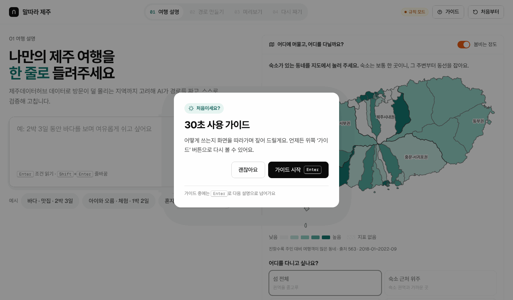

처음 화면에는 "처음이세요? 30초 사용 가이드" 카드가 뜹니다. **Enter** 또는 "가이드 시작"을 누르면 01부터 04까지 화면을 넘어가며 19단계로 안내하고, **Esc** 또는 "괜찮아요"를 누르면 바로 시작합니다.

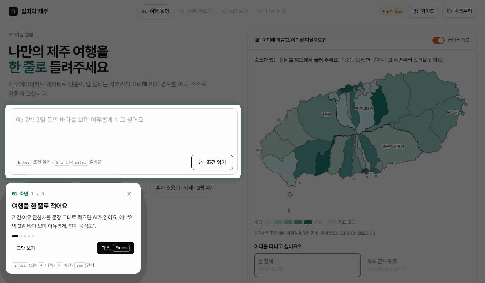

가이드 중에는 비춰진 부분을 실제로 눌러 볼 수 있습니다. 어두운 부분은 눌러도 반응하지 않습니다. 각 화면 마지막 단계의 버튼("경로 만들기", "미리 둘러보기", "다시 짜기")을 누르면 실제로 다음 화면으로 넘어가며 가이드가 이어집니다.

## 1. 01 여행 설명 — 한 줄로 적기

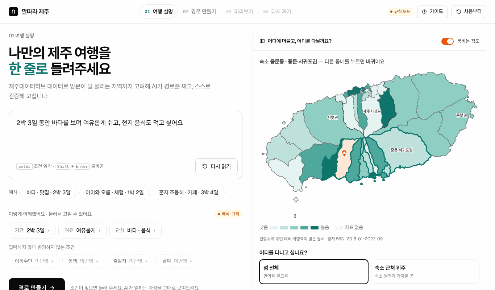

1. 왼쪽 입력창에 여행을 문장 그대로 적고 **Enter**를 누릅니다. 예: "2박 3일 동안 바다를 보며 여유롭게 쉬고, 현지 음식도 먹고 싶어요". 줄을 바꾸려면 Shift+Enter.
   - 잘 모르겠으면 아래 **예시** 버튼을 누르면 바로 채워지고 조건을 읽습니다.
2. **이렇게 이해했어요**: 읽은 조건이 칩으로 나옵니다(기간·여유·관심). 칩 옆 "해석: 규칙/AI"는 누가 읽었는지 표시합니다.
3. **입력하지 않아 반영하지 않는 조건**: 이동수단·동행·출발지·날짜처럼 적지 않은 조건은 회색 "미반영"으로 따로 보여 줍니다. 임의로 채우지 않습니다.
4. 필수는 **여행 기간** 하나입니다. 기간이 없거나 최대 6박 7일을 넘으면 경고가 뜨고 "경로 만들기"가 눌리지 않습니다.

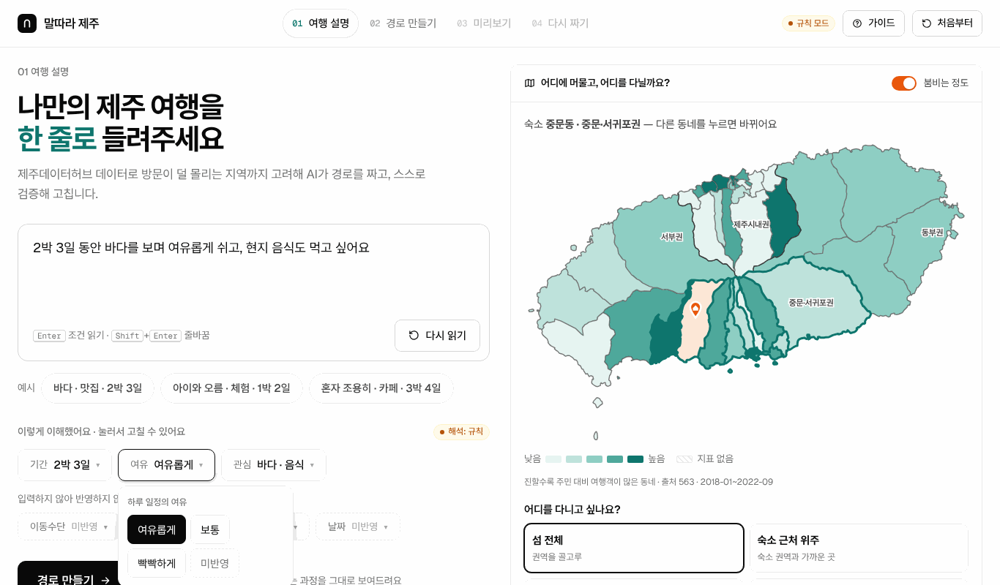

5. 칩을 누르면 값을 바로 고칠 수 있습니다(예: 여유 → 빡빡하게). 관심사는 여러 개 고를 수 있습니다.
6. 오른쪽 **어디에 머물고, 어디를 다닐까요?**
   - **붐비는 정도**(기본 켬): 진할수록 주민 대비 여행객이 많은 동네입니다(제주데이터허브 563, 읍면동 단위). 동네 단위 통계라 개별 장소의 혼잡도는 아닙니다.
   - 지도에서 **숙소 동네**를 누르면 4개 권역(제주시내·서부·동부·중문·서귀포) 중 어디인지 표시됩니다.
   - **다닐 범위**: 섬 전체 / 숙소 근처 / 해안 따라 / 중산간(안쪽).
   - 현재 서버 버전은 숙소·다닐 범위를 화면에 **표시만** 하고 경로 계산에는 아직 쓰지 않습니다(화면에 안내가 나옵니다).
7. 조건이 맞으면 **경로 만들기**를 누릅니다.

## 2. 02 경로 만들기 — AI가 일하는 과정과 결과

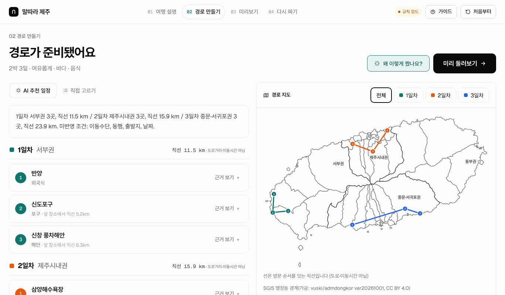

- 경로를 짜는 동안 위쪽 단계 표시(조건 이해 → 후보 찾기 → 일정 짜기 → 검증 → 수정)와 **AI가 한 일** 기록이 한 줄씩 나옵니다. 끝나면 기록은 접힙니다(눌러서 다시 펼침).
- **날짜별 일정**: 하루에 한 권역만 다니고, 가까운 곳끼리 순서대로 이었습니다. 거리는 모두 **직선 거리**이며 도로 거리·이동 시간이 아닙니다.
- **경로 지도**: 방문 순서를 잇는 직선입니다. 위쪽 일차 탭으로 하루씩 볼 수 있고, 지도의 번호를 누르면 그 장소의 근거가 펼쳐집니다.
- 검증에서 고치지 못한 부분이 있으면 "고치지 못한 부분이 있어요" 상자에 그대로 보여 줍니다.

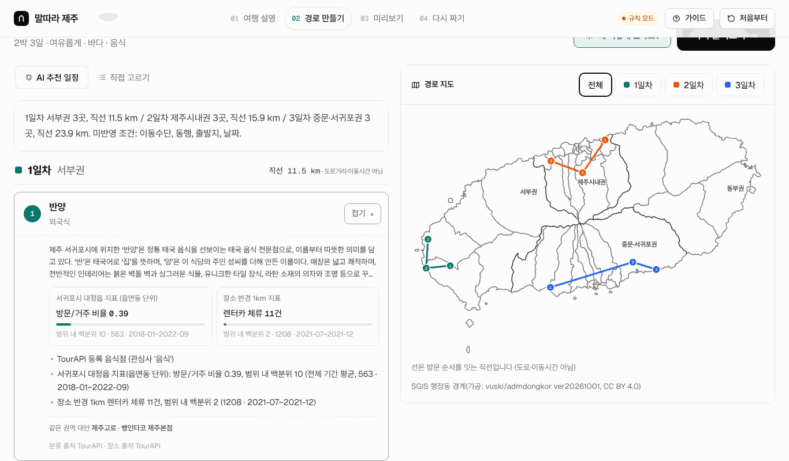

- 장소마다 **근거 보기**를 누르면 고른 이유가 나옵니다: 관심사와 분류가 맞는지, 동네(읍면동)의 방문/거주 비율(563), 장소 반경 1km 렌터카 체류 기록(1208)과 각각의 기간·백분위. 같은 권역의 대안 장소도 보여 줍니다.

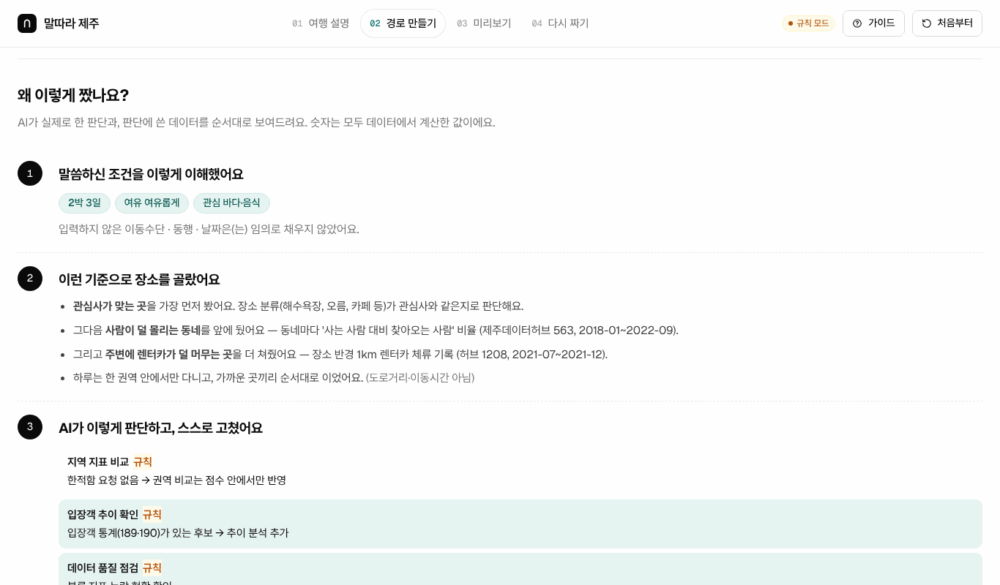

- 위쪽 **왜 이렇게 짰나요?** 버튼을 누르면 아래 설명 섹션으로 이동합니다. ① 조건을 어떻게 이해했는지 ② 어떤 기준으로 골랐는지 ③ AI가 판단하고 스스로 고친 기록 ④ 날짜별로 고른 이유 ⑤ 사용한 데이터와 빈 곳(분류 없음·지표 없음 개수)을 순서대로 보여 줍니다.

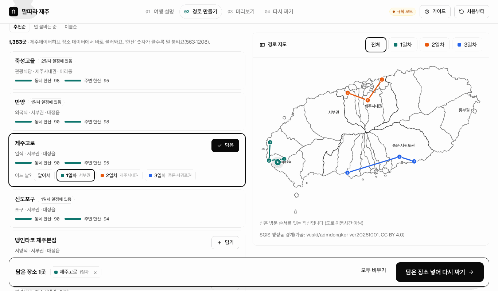

- **직접 고르기**: 왼쪽 위 "AI 추천 일정 / 직접 고르기"를 바꾸면 추천 대상 장소 전체(1,383곳, 분류·권역이 있는 곳)를 검색·필터할 수 있습니다.
  - 이름 검색, 권역(그 권역이 몇 일차인지 함께 표시), 관심 분류, 정렬(추천순·덜 붐비는 순·이름순).
  - 막대 "동네 한산"(563)과 "주변 한산"(1208)은 클수록 덜 붐빈다는 뜻입니다.
  - **담기**를 누르면 같은 권역의 날에 들어갑니다. 날짜를 바꿀 수 있고, 다른 권역의 날을 고르면 "이동 거리가 길어질 수 있어요" 경고가 뜹니다.
  - 아래 바구니(최대 20곳)의 **담은 장소 넣어 다시 짜기**를 누르면 04로 가서 담은 곳을 고정해 다시 짭니다. 같은 날 비슷한 종류(음식은 음식) 중 점수가 낮은 곳과 바뀝니다.
- 준비되면 **미리 둘러보기**를 누릅니다.

## 3. 03 미리보기 — 말 타고 둘러보기 (선택)

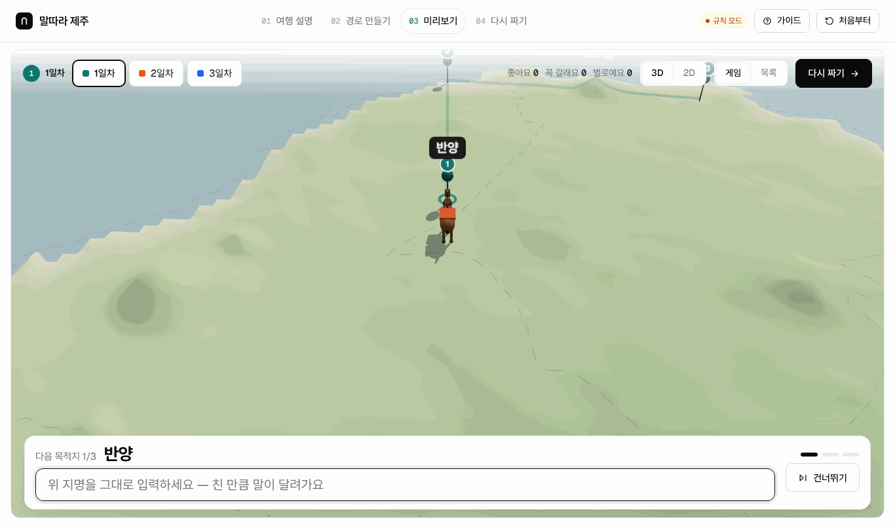

- 제주 지형(3D) 위에 오늘 갈 곳이 핀으로 표시되고, 말이 순서대로 달려갑니다.
- 3D가 느린 PC에서는 자동으로 2D 지도로 바뀌고 안내가 뜹니다. 위쪽 **3D / 2D** 버튼으로 언제든 바꿀 수 있습니다.

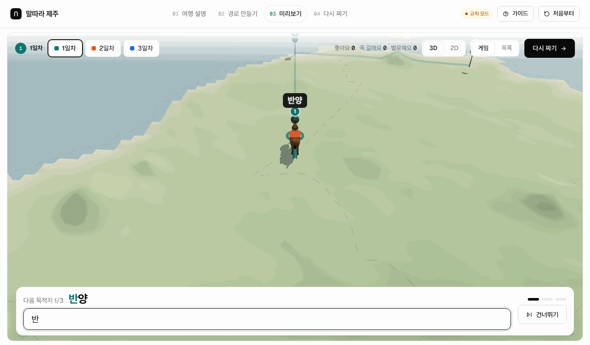

- 아래 **다음 목적지** 이름을 입력창에 그대로 치면, 친 글자만큼 이름이 초록색으로 바뀌고 선과 말이 앞으로 갑니다. 띄어쓰기는 무시합니다.
- 메모처럼 긴 이름(예: "OO식당/메뉴…")은 앞의 짧은 이름만 치면 됩니다.
- 치기 어려우면 **건너뛰기**를 누르거나, 위쪽 **목록** 보기로 바꿔도 같은 기능을 쓸 수 있습니다.

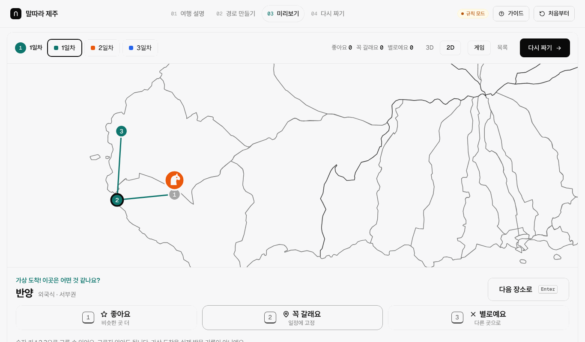

- 다 치면 **가상 도착** 패널이 뜹니다. **1 좋아요**(비슷한 곳 더) · **2 꼭 갈래요**(일정에 고정) · **3 별로예요**(다른 곳으로) 중 하나를 숫자 키나 버튼으로 고릅니다. 고르지 않아도 됩니다.
- 가상 도착은 실제 방문 기록이 아닙니다.
- **Enter**로 다음 장소, 하루가 끝나면 다음 날로 넘어갑니다.

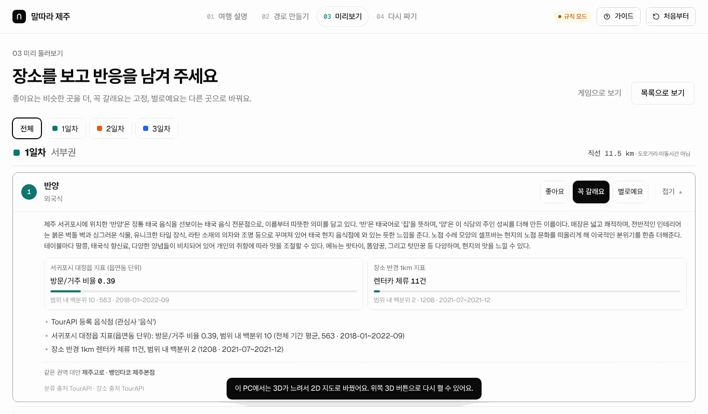

- **목록** 보기에서는 같은 반응 버튼을 장소 카드에서 바로 누를 수 있습니다(게임을 하지 않아도 됩니다).
- 다 둘러보지 않아도 언제든 **다시 짜기**를 누를 수 있습니다.

## 4. 04 다시 짜기 — 최종 계획

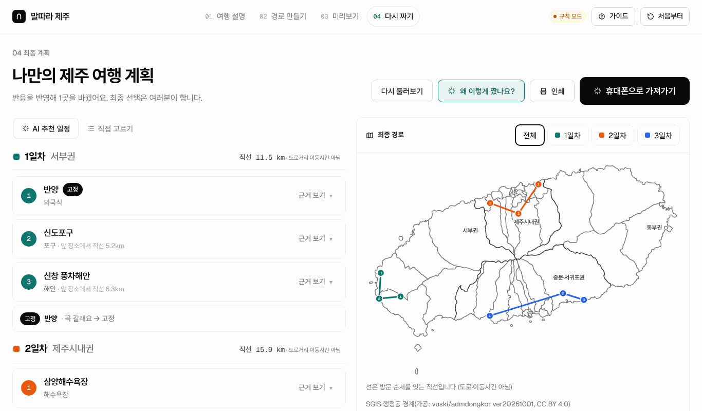

- 반응을 반영해 다시 짠 일정입니다. 바뀐 곳에는 **고정 / 교체 / 추가 / 제외** 표시와 이유가 붙습니다.
  - 꼭 갈래요와 직접 고른 장소는 AI가 바꾸지 않습니다.
  - 별로예요는 같은 권역의 다른 장소로 바꾸고, 대안이 없으면 제외합니다.
- **왜 이렇게 짰나요?**: 무엇을 왜 바꿨는지 반응과 함께 설명합니다.
- 아래 **자세한 데이터(참고)**: 일정 지역의 월별 방문/거주 비율과 관광지 입장객 추이 차트(제주데이터허브 563·189·190).
- 다시 고르고 싶으면 **직접 고르기**로 장소를 담아 한 번 더 다시 짤 수 있습니다.

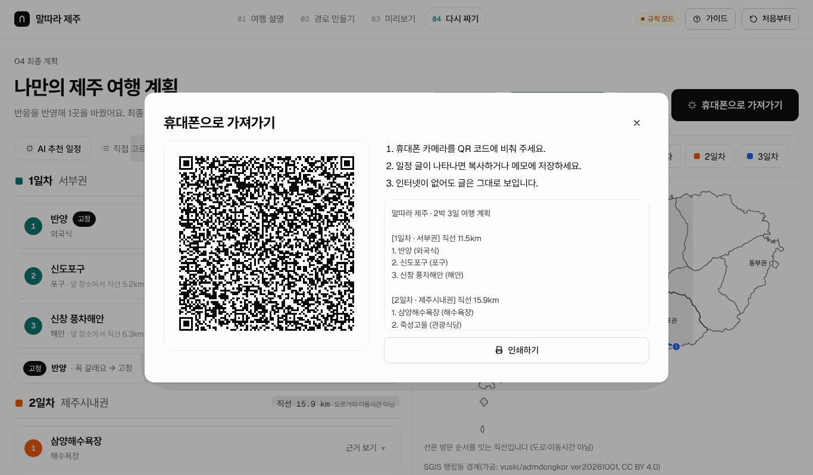

- **휴대폰으로 가져가기**: QR을 휴대폰 카메라로 비추면 일정 글이 나타납니다. 인터넷이 없어도 글은 그대로 보입니다. **Esc**로 닫습니다.
- **인쇄**: 일정과 근거를 인쇄용 문서로 엽니다.
- 다 보셨으면 **처음부터**를 눌러 다음 분을 위해 화면을 비워 주세요.

---

## 알아 두면 좋은 점

- **AI 연결이 없을 때**: 위쪽에 "규칙 모드" 배지가 뜨고, 같은 기능을 규칙 기반으로 수행합니다.
- **거리**: 모든 거리는 직선 거리입니다. 버스 노선·도로 사정·이동 시간은 반영하지 않습니다.
- **이동수단·동행**: 입력하면 화면에 표시하지만 경로 계산에는 쓰지 않습니다(화면에 안내).
- **데이터의 빈 곳**: 원본 장소 기록의 약 절반은 분류가 없어 추천·목록에서 뺐습니다(전체 2,672곳 중 추천 대상 1,383곳). 지표가 없는 장소는 중립값으로 계산했다고 근거에 적습니다.
- **오류가 나면**: 화면의 안내 문장과 "다시 시도" 버튼을 따릅니다. 서버 창(검은 창)이 닫혔다면 `run.bat`을 다시 실행합니다. 자세한 조치는 `manual_run.md` 7장.

## 키보드 정리

| 키 | 어디서 | 동작 |
|---|---|---|
| Enter | 01 입력창 | 조건 읽기 (Shift+Enter 줄바꿈) |
| Enter / → · ← · Esc | 사용 가이드 | 다음 · 이전 · 닫기 |
| 1 · 2 · 3 | 03 가상 도착 | 좋아요 · 꼭 갈래요 · 별로예요 |
| Enter | 03 가상 도착 / 하루 끝 | 다음 장소 / 다음 날 |
| Esc | 04 QR 창 | 닫기 |
| Ctrl+Shift+D | 어디서나 | 시연 모드(검증·수정 과정을 보여 주는 오류 주입 스위치) |
