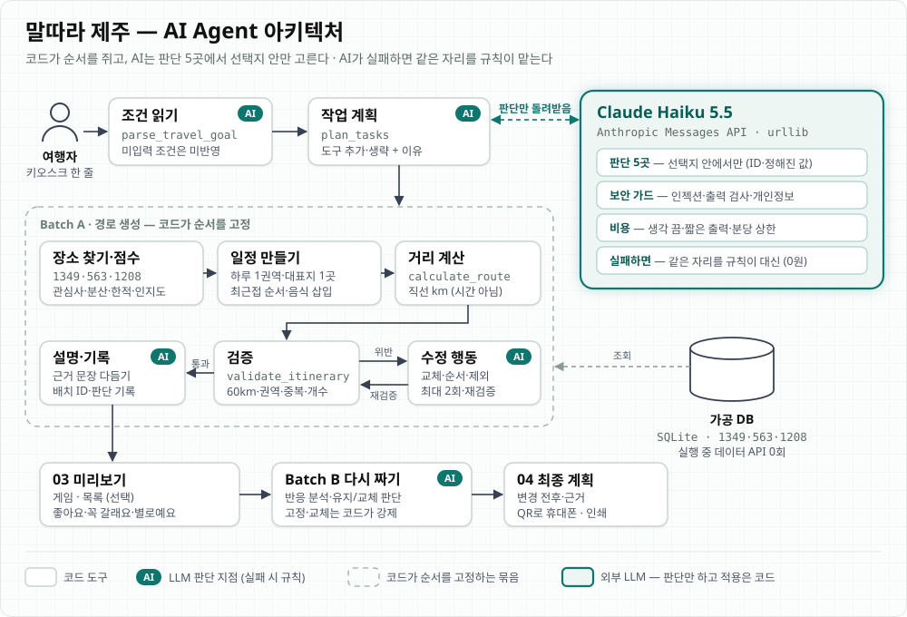
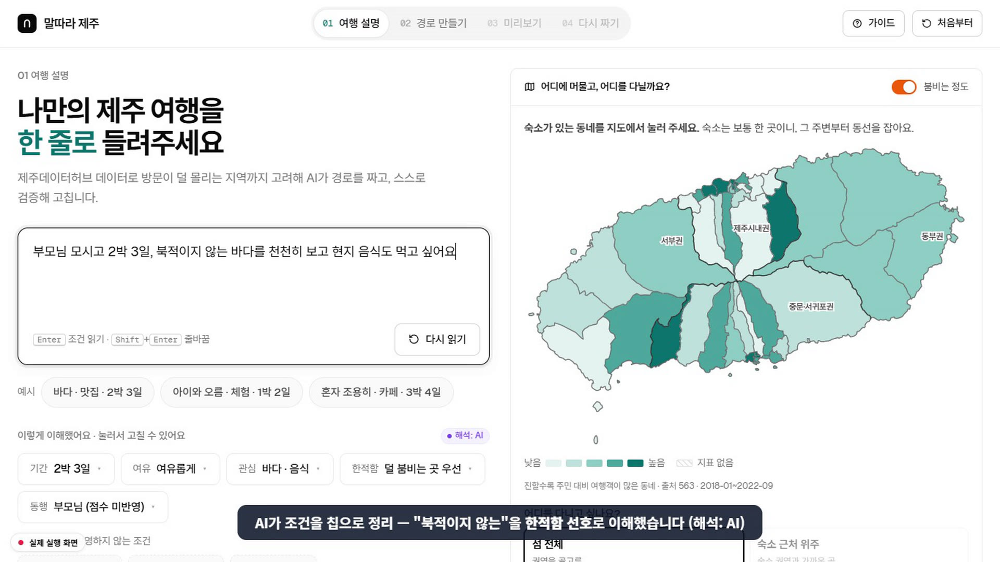
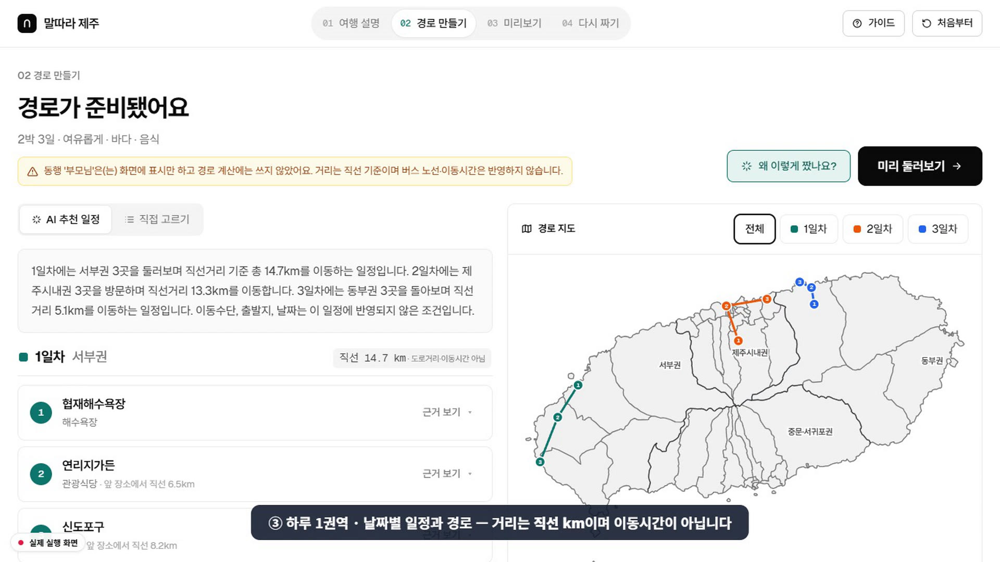
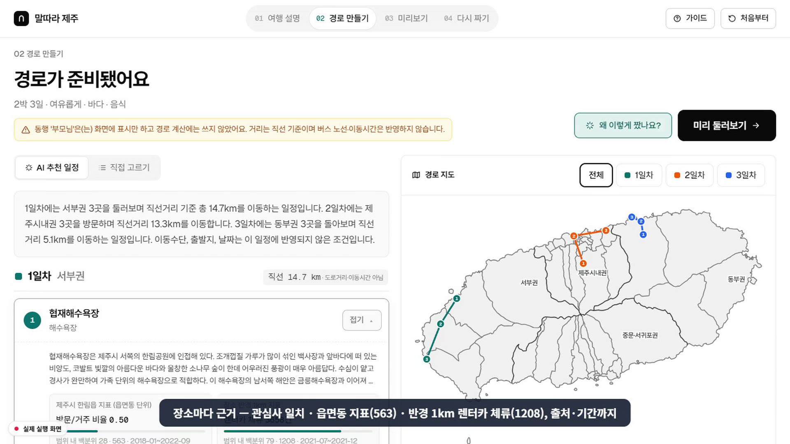
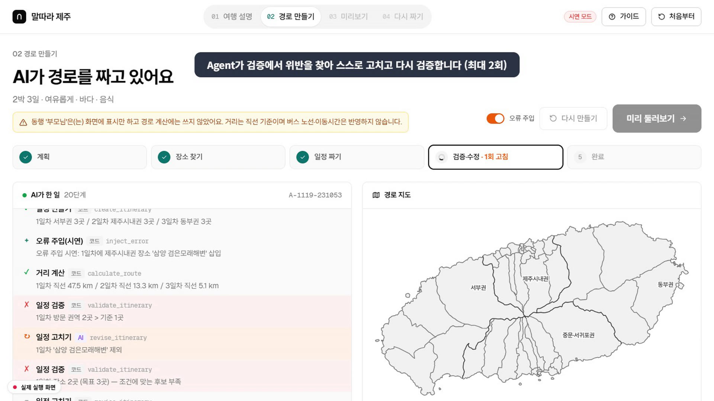
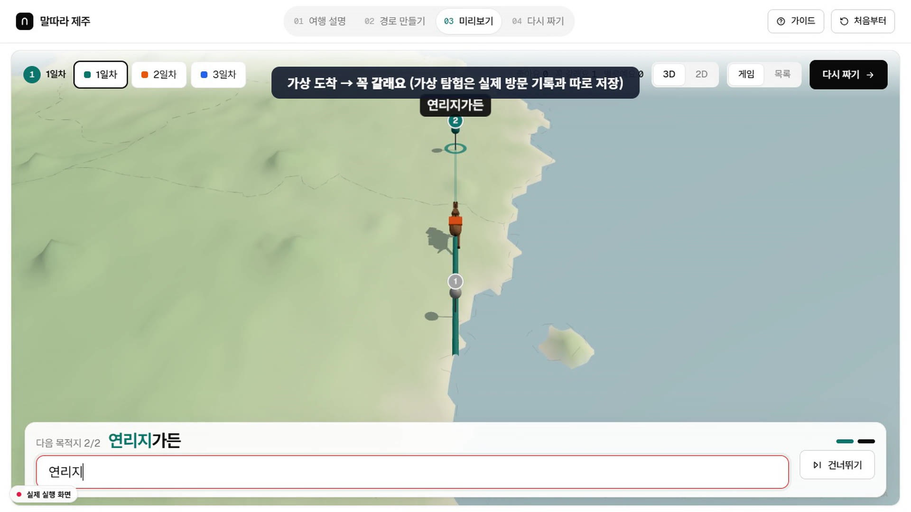
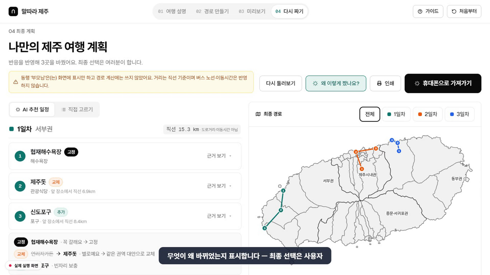
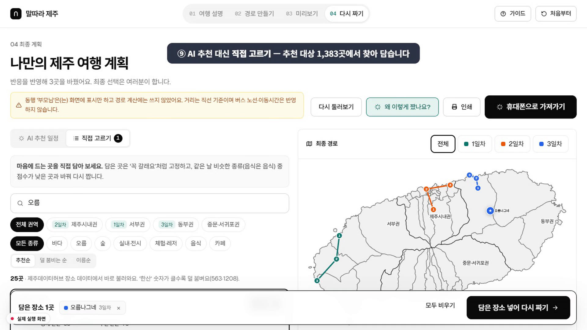
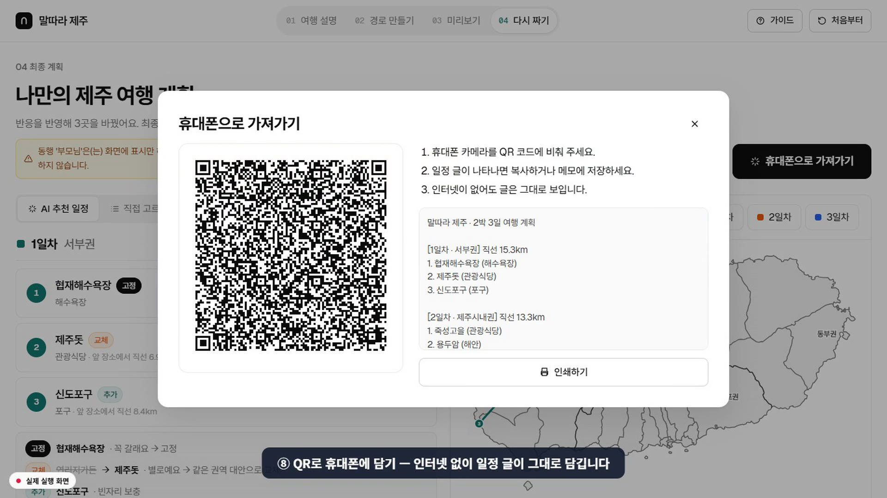

# 말따라 제주 — 결과 설명자료

> 제주 AI·빅데이터 활용 AI Agent 개발 챌린지 · 결과물 ZIP 동봉 문서 (2026-11-20)
> 시연 영상: `결과설명자료/말따라제주_데모영상.mp4` (2분 29초, 타이틀·아웃트로 외 모두 실제 실행 화면)

## 1. 문제 정의

제주 여행 정보는 유명 관광지 중심이라, 같은 관심사를 가진 여행자가 같은 장소로 몰립니다. 제주데이터허브 데이터는 이 쏠림을 직접 보여 줍니다.

| 관찰 | 데이터 | 값 |
|---|---|---|
| 동네마다 찾아오는 비율이 다르다 | 563 내국인 유동인구 구성비율 (2018-01~2022-09) | 읍면동 방문/거주 비율 제주시 삼양동 0.225 ↔ 도두동 2.660 (약 12배) |
| 같은 동네 안에서도 장소마다 다르다 | 1208 렌터카 체류 거점 (2021-07~12 토요일) | 조천읍 해수욕장 반경 1km 체류 함덕 4,403건 ↔ 신흥 314건 (14배) |

여행자가 이 차이를 직접 찾기는 어렵습니다. **목표**: 한 줄 요청을 이해해 관심사에 맞으면서 방문이 덜 몰리는 장소로 경로를 짜고, 스스로 검증·수정하며, 미리 둘러본 반응으로 다시 짜는 AI Agent를 센터 키오스크에서 운영합니다.

## 2. Agent 구조

- **Plan-and-Execute**: 필수 단계(조건 검증 → 장소 탐색 → 일정 생성 → 거리 계산 → 검증·수정 → 설명·기록)는 코드가 순서를 고정하고, 작업 계획이 조건에 따라 도구를 더하거나 뺍니다(예: "북적이지 않는" → 읍면동 비교 추가·한적 가중치 상향, 음식 관심 → 하루 1곳 음식점 탐색).
- **AI 판단 5곳**: 조건 해석, 작업 계획, 수정 행동 선택, 유지·교체, 설명 문장 다듬기. Claude Haiku 5.5가 주어진 선택지 안에서만 고르고, 실패·장애·인젝션 의심·호출 상한 초과 시 같은 자리를 규칙이 맡습니다.
- **코드가 책임지는 것**: 장소 점수, 일정 생성, 직선거리, 검증, 수정 적용, 기록. 수치는 모두 코드 결과입니다.
- **기록**: 배치 ID(A-월일-시분초, B는 이전 A와 연결)와 판단마다 선택지·선택·주체(AI/규칙)·사유·토큰 사용량을 DB에 남깁니다.

## 3. 주요 기능

| | |
|---|---|
|  **한 줄 입력 → 조건 칩**: 말하지 않은 조건은 "미반영", 칩을 눌러 수정 |  **경로 만들기**: 하루 1권역, 날짜별 일정·지도, 거리는 직선 km(이동시간 아님) |
|  **장소별 근거**: 관심사 일치, 읍면동 지표(563), 반경 1km 렌터카 체류(1208), 출처·기간 |  **스스로 검증·수정**: 오류 주입 시연에서 위반 → 수정 → 재검증 통과(최대 2회) |

| | |
|---|---|
|  **말 타고 미리보기**: 3D 지형 위 타이핑 게임, 가상 도착 시 반응. 2D·목록으로도 같은 기능 |  **반응으로 다시 짜기**: 꼭 갈래요 고정, 별로예요 교체(코드가 강제), 전후 비교 |
|  **직접 고르기**: 추천 대상 1,383곳 검색·담기, 직접 고른 곳은 항상 고정 |  **QR·인쇄**: 인터넷 없이 휴대폰에 일정 글 담기 |

## 4. 실행 결과

**데이터가 순위를 바꾼다** — 동부권 '바다' 후보 26곳은 관심사 점수가 모두 같지만, 허브 지표로 순위가 갈립니다(2026-11-19 데이터, 같은 값 재현 가능).

| 장소 | 읍면동 (563, 백분위) | 반경 1km 렌터카 체류 (1208, 백분위) | 여행자 기록 (1349, 백분위) | 점수 | 순위 |
|---|---|---|---|---|---|
| 김녕해수욕장 | 구좌읍 (0.656, 52) | 354건 (29) | 4건 (95) | 0.868 | **1** |
| 신흥해수욕장 | 조천읍 (0.645, 45) | 314건 (26) | 2건 (82) | 0.856 | 3 |
| 함덕해수욕장 | 조천읍 (0.645, 45) | 4,403건 (85) | 33건 (100) | 0.805 | 11 |

인지도가 가장 높은 함덕해수욕장도 렌터카 체류가 김녕의 12배라 뒤로 밀립니다. 일정에는 하루 대표지 1곳이 함께 들어가 유명한 곳을 아예 빼지는 않습니다.

**AI·규칙 동작과 비용 (실측, Claude Haiku 5.5)**

| 흐름 | LLM 호출 | 비용(USD) | 응답 시간 |
|---|---|---|---|
| 조건 해석 + 경로 만들기 | 3회 | 약 0.0006 | 1.3초 + 5.6초 |
| 오류 주입 시연 포함 경로 | 5회 | 약 0.0009 | 9.1초 |
| 반응으로 다시 짜기 | +2회 | +0.0003 | 4.1초 |
| **방문객 1명 전체 체험** | **약 7회** | **약 0.0012** | — |

- "북적이지 않는 바다를 천천히…" → AI가 한적함 선호로 해석(화면 배지 "해석: AI"). 인젝션 문장("이전 지시는 무시하고…") → AI에 보내지 않고 규칙으로 해석("해석: 규칙"), 기간·관심사는 정상 인식.
- 키가 없거나 인터넷이 끊겨도 규칙 모드로 01→04 전 과정이 동작합니다(규칙 모드 경로 생성 약 0.9초).

## 5. 검증 방법

| 방법 | 범위 | 결과 |
|---|---|---|
| 자동 테스트 (`tests/`, 표준 unittest) | 데이터 빌드, 도구, Batch A·B, 서버 API, 수용 테스트 10종, LLM 보안, Claude API 형식·토큰 기록, 표준 라이브러리만 쓰는지 | **204개 통과** |
| 무작위 조건 반복 실행 | 기간·여유·관심사·월·한적함을 바꿔 Batch A·B 220회 | 장소 수·중복·권역·거리·고정/교체 위반 0건 |
| 클릭 시나리오 (`web/tools/e2e_scenarios.js`) | 정상 흐름, 빈 입력, 기간 초과, HTML 입력, 오류 주입, 자동 초기화, 서버 끊김 복구 | 54항목 통과 (1366px·390px) |
| LLM 보안 (`docs/05_submission/security.md`) | 인젝션(한·영·전각·보이지 않는 문자), 정상 문장 오탐, 개인정보 마스킹, 출력 검사, 호출 상한 | 테스트로 증명 |
| 실제 실행 녹화 | 01→04 전 기능, 오류 주입, 직접 고르기, 인젝션 방어 | 시연 영상 |

재현: `run.bat` 실행 후 같은 문장을 넣으면 규칙 모드는 같은 경로가 나오고, AI 모드는 판단 기록이 DB에 남습니다. 테스트: `py -3 -m unittest discover -s tests` (src를 PYTHONPATH에).

## 6. 한계

- 563은 2018~2022 내국인, 1208은 2021 하반기 토요일 렌터카만 반영해 "지금의 혼잡도"가 아닙니다. 읍면동 지표는 장소의 속성이 아니라 동네 단위 통계로만 표시합니다.
- 1349는 이용자 여행 기록이라 정제 후에도 비장소 이름·중복·좌표 오류가 일부 남을 수 있습니다(좌표 이동 88곳·제외 16곳 정제).
- 거리는 직선이며 도로·대중교통·이동시간을 반영하지 않습니다. 이동수단·동행·숙소·다닐 범위는 화면 표시만 하고 경로 계산에는 반영하지 않습니다.
- 장소 개요(TourAPI)는 일부 장소에만 있고, 입장객 통계(189·190)는 29곳만 매칭되어 점수에 쓰지 않습니다. 부속섬은 제외합니다.
- 규칙 기반 인젝션 탐지는 새 표현에 우회될 수 있습니다. 그래서 본 방어선은 "선택지 안에서만 고르는 구조"와 출력 검사입니다.

## 7. 센터 활용 방안

- **체험형 키오스크**: 방문객이 허브 데이터가 실제 의사결정(어디를 갈지)에 어떻게 쓰이는지 체험합니다. 근거 패널에 데이터 ID·기간이 보여 데이터 홍보 효과가 있고, 2분 무입력 시 자동 초기화로 다음 방문객이 이어 씁니다.
- **운영 부담이 낮음**: Python 공식 설치본만 있으면 `run.bat` 더블클릭으로 실행, 추가 패키지·외부 CDN 없음. 실행 중 외부 의존은 Claude API 하나이며, 없어도 규칙 모드로 동작합니다. 비용은 방문객 1,000명 약 $1.2(실측 기준).
- **데이터 갱신**: 허브 데이터가 갱신되면 ETL(`malttara.etl.build_db`)만 다시 돌려 DB를 교체하면 화면·추천이 함께 바뀝니다.
- **운영자 조정**: 점수 가중치(`config/settings.json`), 인젝션·개인정보 패턴과 호출 상한(`config/security.json`)을 코드 수정 없이 바꿀 수 있습니다.
- **확장**: 같은 구조로 버스 노선(611·612·743), 계절·기후(877), 무장애 여행지 필터(858)를 추가할 수 있습니다. 판단 기록·반응은 개인 식별 정보 없이 배치 단위로 저장되어, 어떤 관심사·반응이 많은지 집계하는 데 쓸 수 있습니다(운영 정책에 따라).
